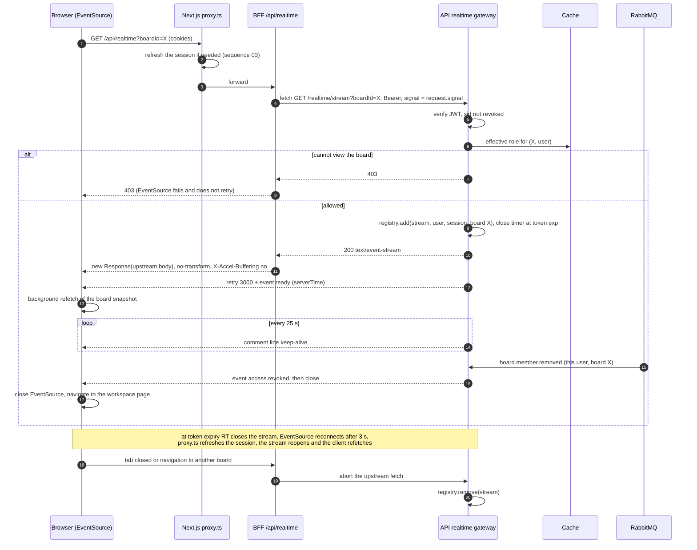

# Sequence 19 · SSE connection lifecycle (through the BFF)

> Index: [07 · Sequence flows](../../07-sequence-flows.md) · State: [SSE client connection](../state/15-sse-client-connection.md) · Contract: [09 · API §5](../../09-api-contract.md#5-realtime-sse-contract) · Decision: [ADR-005](../../11-decisions.md#adr-005)

## Notes

- **One stream per tab.** It always carries the **user channel** (notifications, own watch changes). It also carries the **board channel** when `boardId` is given. Switching boards closes and reopens the stream.
- HTTP/2 between browser and edge removes the 6-connections-per-origin limit of HTTP/1.1 for multi-tab users.
- BFF route handler: `export const dynamic = 'force-dynamic'`, Node.js runtime, no response caching.
