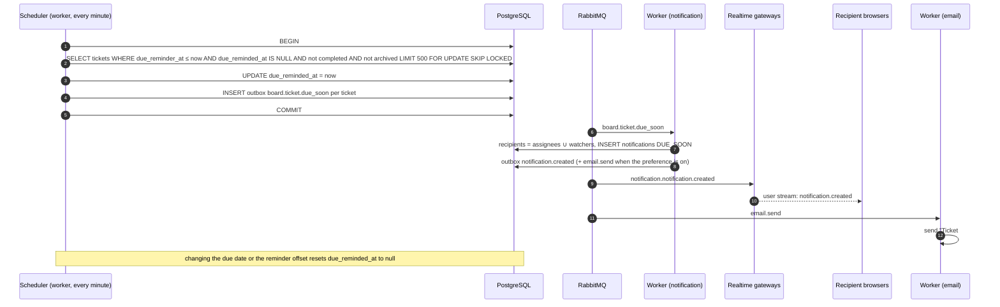

# Sequence 20 · Due-date reminder (P2)

> Index: [07 · Sequence flows](../../07-sequence-flows.md) · State: [Due status](../state/09-ticket-due-status.md) · Use case: [Collaboration](../use-case/05-collaboration.md)

## Notes

- `SKIP LOCKED` lets several workers run the job safely. Each row is claimed once.
- Reminders are evaluated in UTC. The email renders times in the recipient's `time_zone`.
