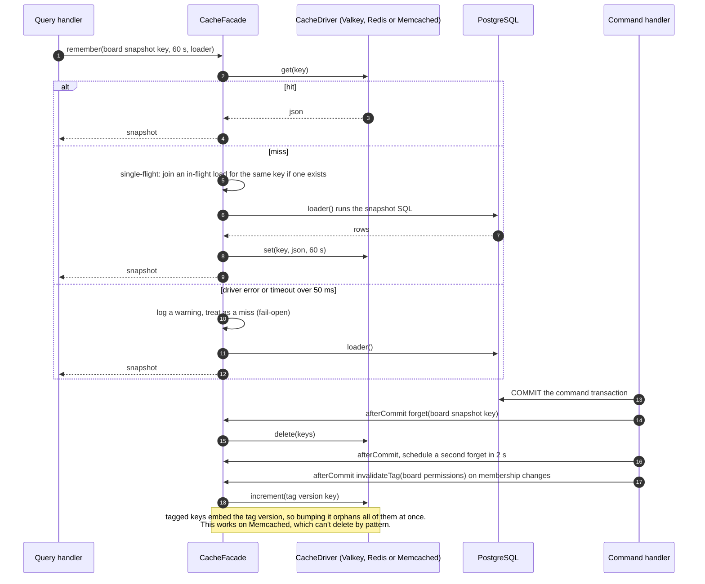

# Sequence 21 · Cache-aside read and invalidation through the CacheFacade

> Index: [07 · Sequence flows](../../07-sequence-flows.md) · Class: [Cache facade](../class/08-cache-facade.md) · Infrastructure: [10 §4](../../10-infrastructure.md#4-cache-facade)

## Notes

- **Stale-set race:** a reader that loaded old rows just before the commit can write them *after* the delete. The delayed second delete and the short TTL bound this window. Realtime events correct open clients regardless.
- **Fail-open everywhere.** The cache is an optimisation. Rate limiting also fails open (configurable per bucket).
- What's cached, and for how long: [10 · Infrastructure §4](../../10-infrastructure.md#4-cache-facade).
