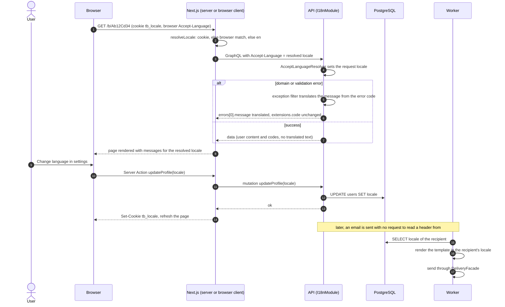

# Sequence 22 · Locale propagation (web, API, worker)

> Index: [07 · Sequence flows](../../07-sequence-flows.md) · Design: [12 · Internationalisation](../../12-internationalisation.md) · Decision: [ADR-023](../../11-decisions.md#adr-023)

## Notes

- The BFF replaces the browser's `Accept-Language`, so the API always receives one supported value.
- Notifications and activities aren't translated on the server. They're stored as `type` + `data` and rendered by the web app in the viewer's language.
