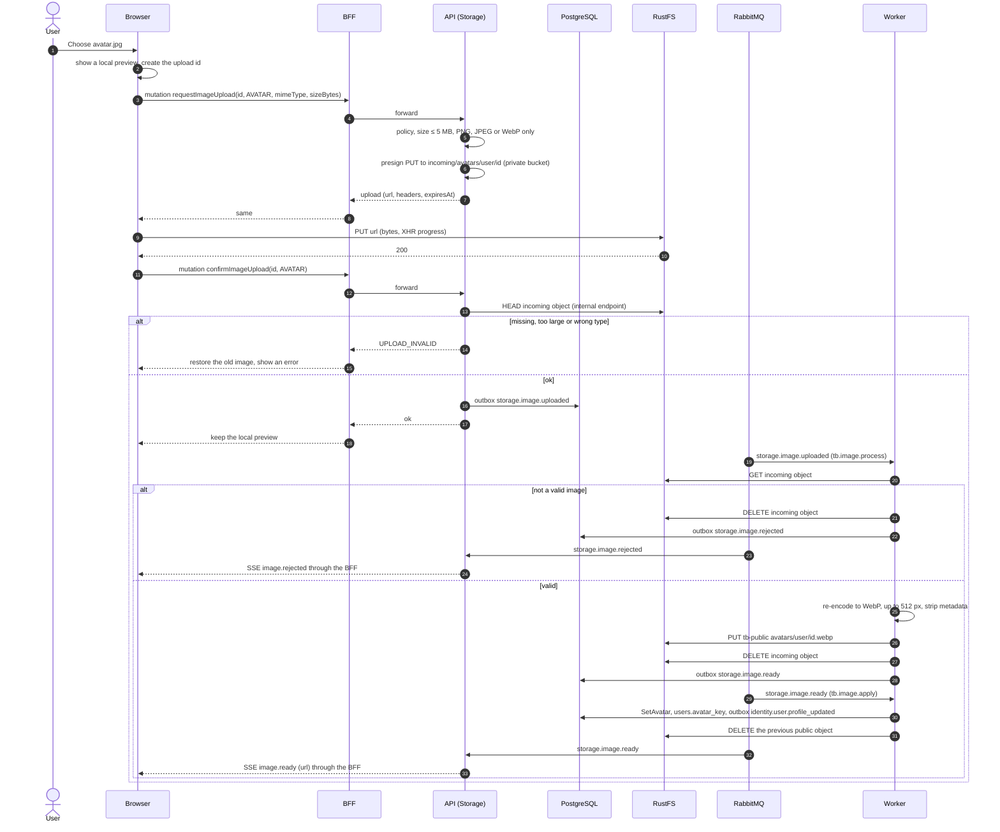

# Sequence 23 · Avatar and workspace logo upload

> Index: [07 · Sequence flows](../../07-sequence-flows.md) · Details: [13 · File uploads §6](../../13-file-uploads.md#6-avatars-and-logos) · Attachments: [Sequence 16](./16-attachment-upload.md) · Class: [Storage](../class/06-storage.md)

## Notes

- **The browser never writes to `tb-public`.** That bucket allows anonymous reads, so only the worker's re-encoded output goes there.
- There's no database row during the upload. The API rebuilds the key from the signed-in user or a checked `workspaceId`, so nobody can confirm someone else's upload.
- A workspace logo follows the same flow with `purpose = WORKSPACE_LOGO`, a workspace admin check and `SetWorkspaceLogo`.
- A job every 15 minutes deletes `incoming/` objects older than 1 hour.
