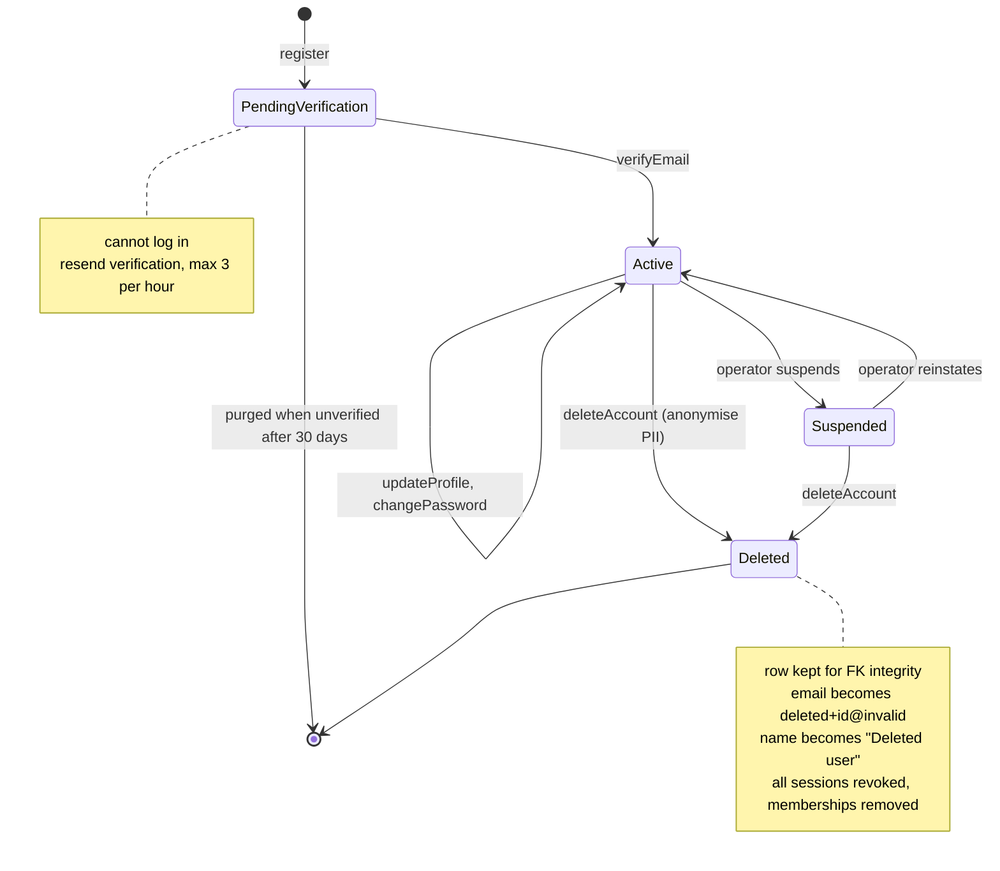

# State · User account

> Index: [08 · State machines](../../08-state-machines.md) · Column: `users.status` · Class: [Identity](../class/02-identity.md) · Sequences: [01](../sequence/01-sign-up-and-verify-email.md), [02](../sequence/02-login.md)

| State | Can log in | Visible to others |
|---|---|---|
| `pending_verification` | ❌ (`EMAIL_NOT_VERIFIED`) | ❌ |
| `active` | ✅ | ✅ |
| `suspended` | ❌ (`ACCOUNT_SUSPENDED`) | ✅ (greyed out) |
| `deleted` | ❌ | as "Deleted user" in history |
