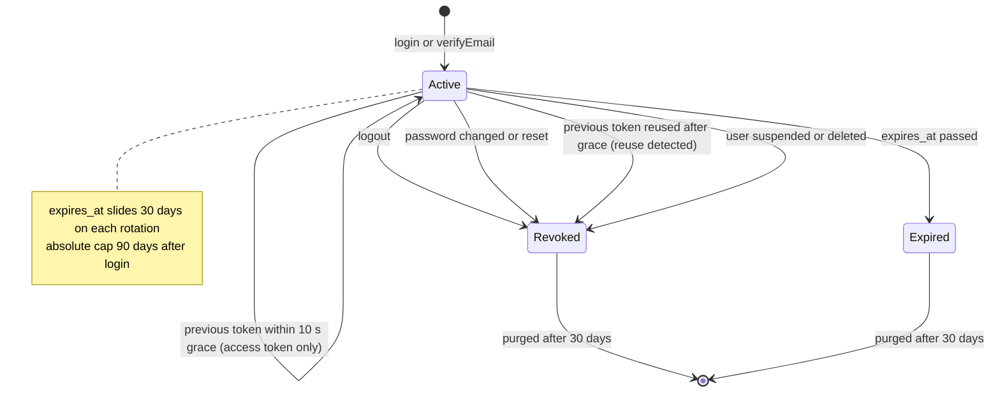

# State · Session (refresh-token rotation)

> Index: [08 · State machines](../../08-state-machines.md) · Table: `sessions` · Sequences: [02](../sequence/02-login.md), [03](../sequence/03-silent-session-refresh.md), [04](../sequence/04-logout-and-session-revocation.md)

On entering `Revoked`, the API writes the revoked-sid cache marker and emits `identity.session.revoked`. That closes the session's SSE streams.
