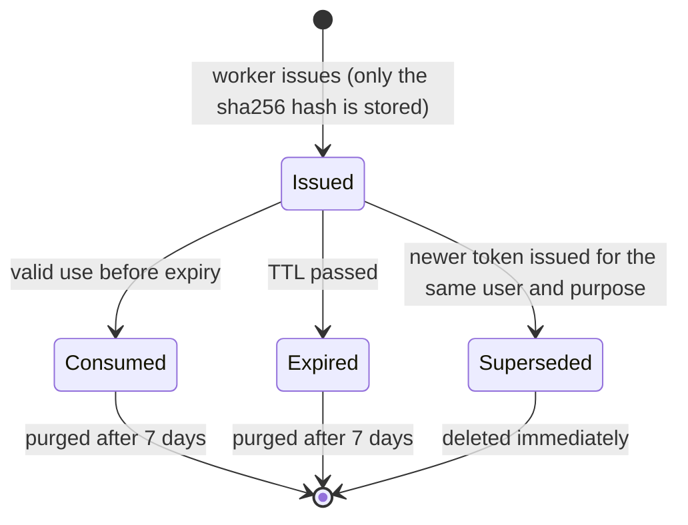

# State · Verification token (email verification, password reset, email change)

> Index: [08 · State machines](../../08-state-machines.md) · Table: `verification_tokens` · Sequences: [01](../sequence/01-sign-up-and-verify-email.md), [05](../sequence/05-password-reset.md)

| Purpose | TTL | On consume |
|---|---|---|
| `email_verification` | 24 h | user → `active`, session created |
| `password_reset` | 1 h | password replaced, all sessions revoked |
| `email_change` (P2) | 24 h | `users.email` = `new_email`, notice sent to the old address |
