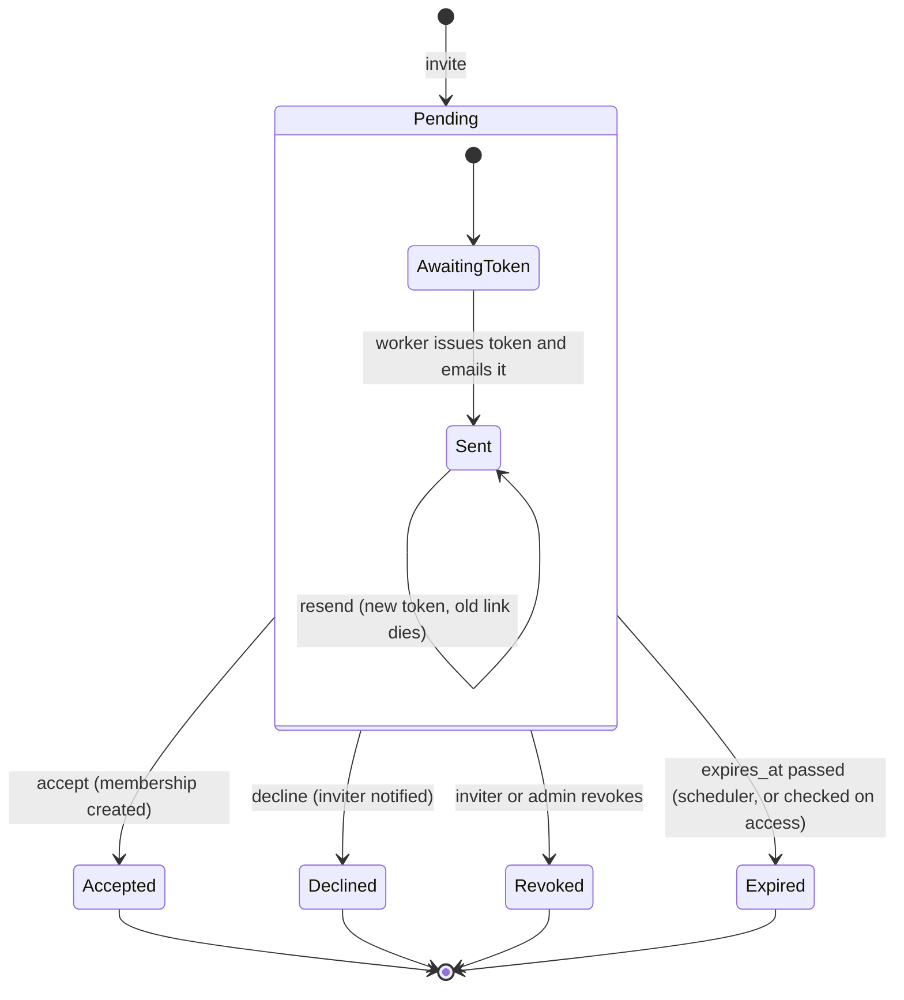

# State · Invitation

> Index: [08 · State machines](../../08-state-machines.md) · Column: `invitations.status` · Sequence: [07](../sequence/07-invite-and-accept-invitation.md) · Activity: [Accept invitation](../activity/02-accept-invitation.md)

- Terminal states are kept for audit ("invited by X on …").
- A new invitation to the same email is allowed once the previous one has left `Pending` (partial unique index).
