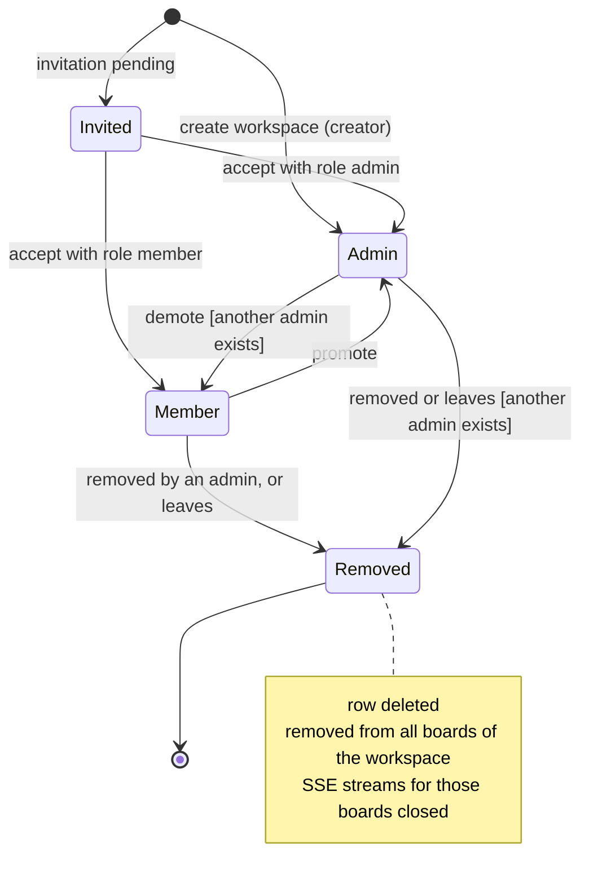

# State · Workspace membership

> Index: [08 · State machines](../../08-state-machines.md) · Table: `workspace_members` · Class: [Workspace](../class/03-workspace.md)

`Invited` lives in the `invitations` table, not in `workspace_members`. It's shown here to give the full lifecycle. **Board membership** follows the same shape with the roles `admin / member / observer` and the guard "another board admin exists".
