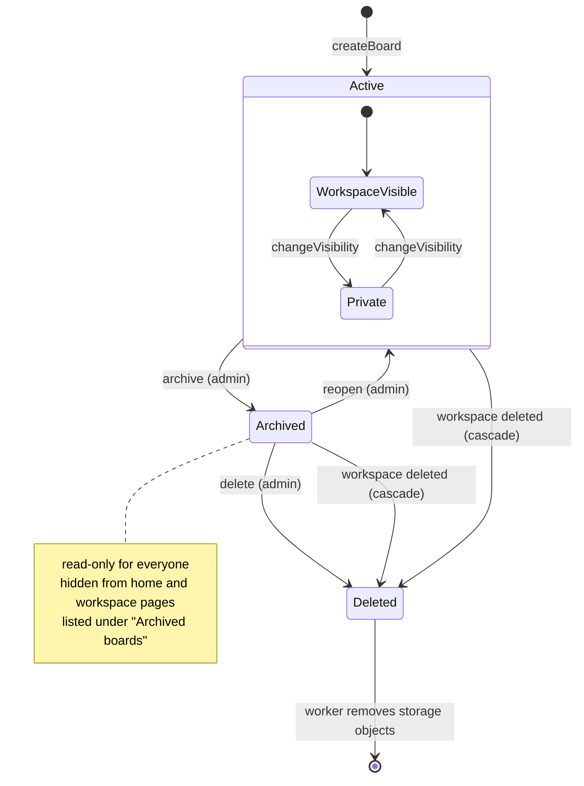

# State · Board

> Index: [08 · State machines](../../08-state-machines.md) · Columns: `boards.archived_at`, `boards.visibility` · Use case: [UC-BRD-09/10](../use-case/03-board.md#uc-brd-0910--archive-and-delete-board)

| Transition | Realtime event to viewers | Client reaction |
|---|---|---|
| visibility changed | `board.updated` | Viewers who lose access get `access.revoked` |
| → Archived | `board.archived` | Read-only banner, editing disabled |
| → Active (reopen) | `board.reopened` | Editing enabled |
| → Deleted | `board.deleted` | Redirect to the workspace with a toast |
