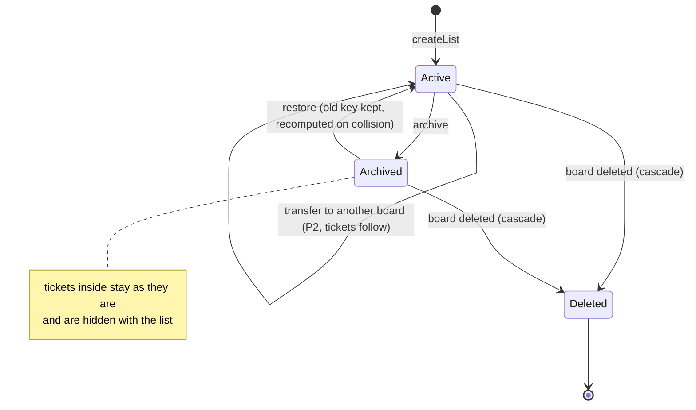

# State · List

> Index: [08 · State machines](../../08-state-machines.md) · Column: `lists.archived_at` · Class: [Board](../class/04-board.md)

Lists are never deleted on their own, only archived, the same as in Trello.
