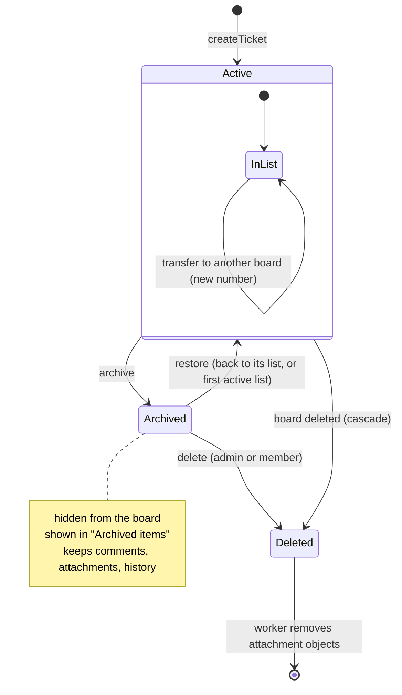

# State · Ticket

> Index: [08 · State machines](../../08-state-machines.md) · Column: `tickets.archived_at` · Class: [Board](../class/04-board.md) · Sequences: [10](../sequence/10-create-ticket.md), [11](../sequence/11-move-ticket-realtime.md), [13](../sequence/13-move-ticket-across-boards.md)

- Restoring a ticket whose list is archived → it goes to the first active list, at the bottom.
- Delete requires the ticket to be archived first (UI rule, mirrors Trello). Bulk cascades skip that rule.
