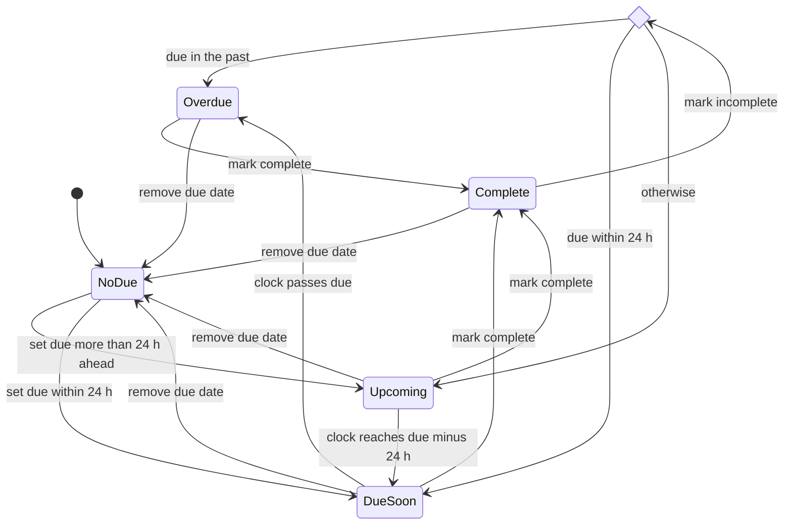

# State · Ticket due status (derived)

> Index: [08 · State machines](../../08-state-machines.md) · Computed by `TicketDates.statusAt(now)` · Sequence: [20](../sequence/20-due-date-reminder.md) · UI: [Ticket front badges](../ui/03-ticket-card-wireframe.md)

This status is **derived, not stored**. It's computed from `due_at`, `due_completed_at` and `now` on the client (to keep chips fresh without events) and on the server (for reminders).

| Status | Chip color | Reminder |
|---|---|---|
| NoDue | — | — |
| Upcoming | neutral | fires at `due_reminder_at` if set |
| DueSoon | yellow | fires at `due_reminder_at` if set |
| Overdue | red | — |
| Complete | green | cancelled (`due_completed_at` set) |
