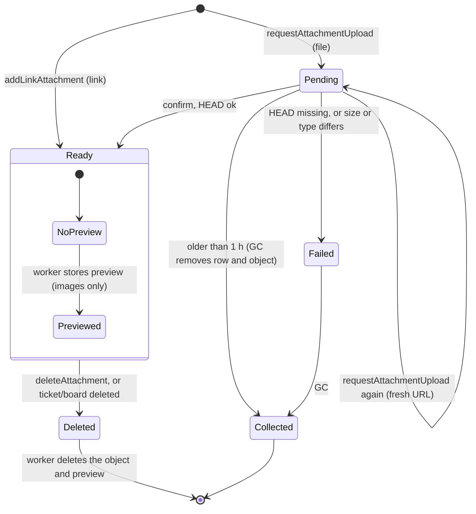

# State · Attachment

> Index: [08 · State machines](../../08-state-machines.md) · Column: `attachments.status` · Sequences: [16](../sequence/16-attachment-upload.md), [17](../sequence/17-attachment-download.md) · Class: [Storage](../class/06-storage.md)

- Only `Ready` attachments count in badges, appear in lists and can become a cover.
- Deleting the attachment used as cover resets the ticket's cover (`ON DELETE SET NULL` + domain clears `cover_kind`).
