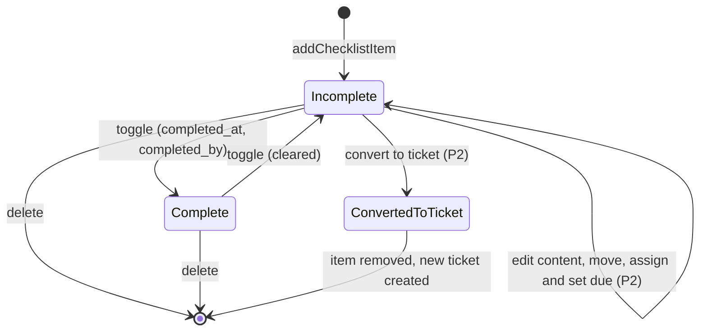

# State · Checklist item

> Index: [08 · State machines](../../08-state-machines.md) · Column: `checklist_items.completed_at` · Class: [Board](../class/04-board.md)

Each transition emits `board.checklist_item.*`, which updates the `checklist x/y` badge live for every viewer.
