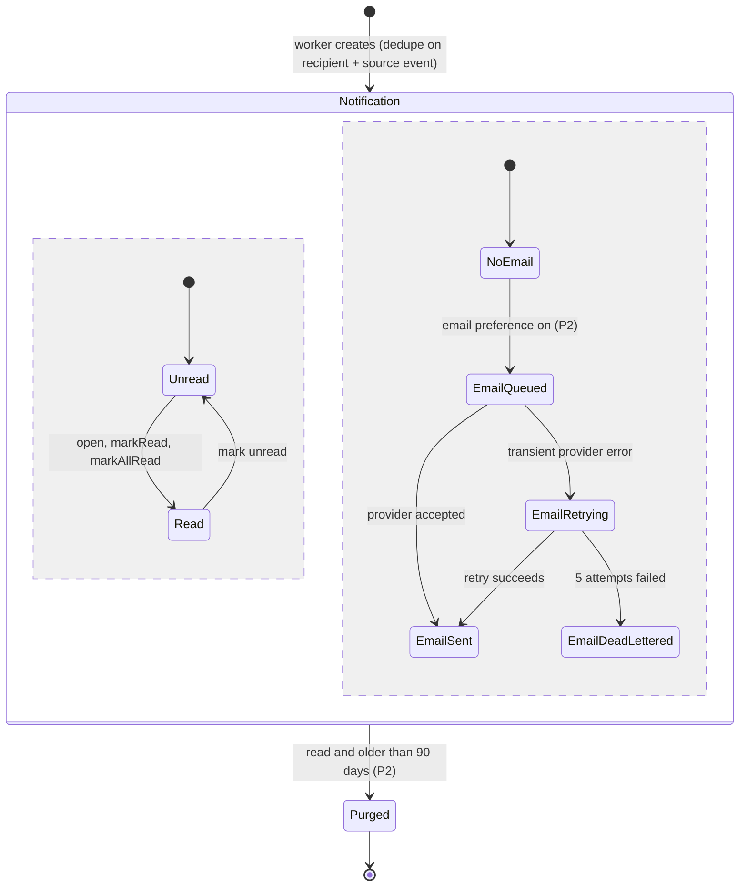

# State · Notification (in-app read state and email delivery)

> Index: [08 · State machines](../../08-state-machines.md) · Table: `notifications` · Sequence: [15](../sequence/15-comment-mention-notification.md) · Class: [Notification](../class/07-notification.md)

The two regions are independent. Reading a notification doesn't cancel a queued email. Only one email is sent per notification (idempotent on `notification.id`).
