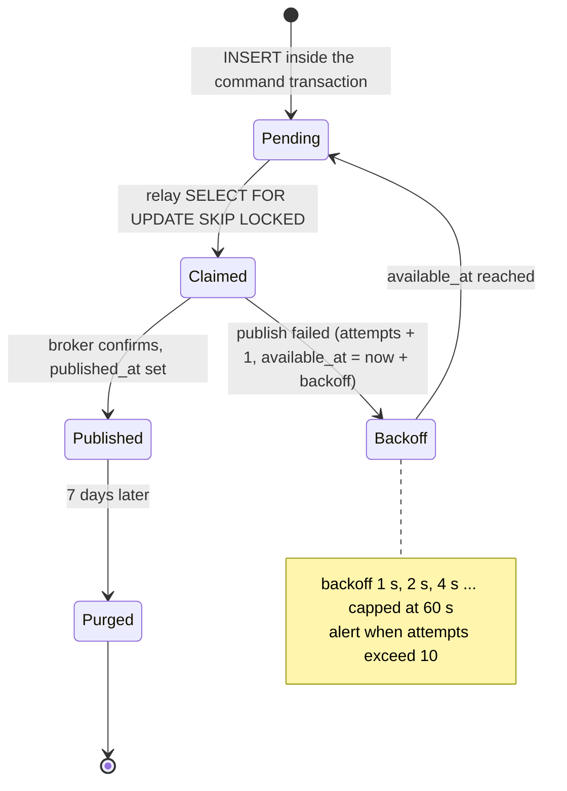

# State · Outbox event

> Index: [08 · State machines](../../08-state-machines.md) · Table: `outbox_events` · Sequence: [18](../sequence/18-outbox-relay-and-consumers.md)

`Claimed` exists only inside the relay's transaction. A relay crash rolls it back to `Pending`, and the event is published again (consumers are idempotent).
