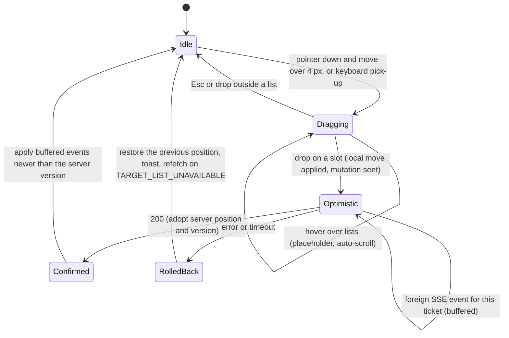

# State · Ticket drag (client UI)

> Index: [08 · State machines](../../08-state-machines.md) · Sequence: [11](../sequence/11-move-ticket-realtime.md) · Use case: [UC-TKT-04](../use-case/04-list-and-ticket.md#uc-tkt-04--move-ticket-drag-and-drop)

The ticket can be dragged again while `Optimistic`. Each drop gets its own `clientMutationId`, and the latest server response wins.

## dnd-kit mapping

| State change | dnd-kit |
|---|---|
| Idle → Dragging | `onDragStart`. `PointerSensor` with a 4 px `activationConstraint`, or `KeyboardSensor` with sortable coordinates |
| Dragging (hover) | `onDragOver` moves the placeholder between `SortableContext`s |
| Dragging → Idle | `onDragCancel` |
| Dragging → Optimistic | `onDragEnd` computes the neighbours and sends `moveTicket` |

`DndContext` needs a stable `id` prop, so its generated ARIA ids match between server and client render.
