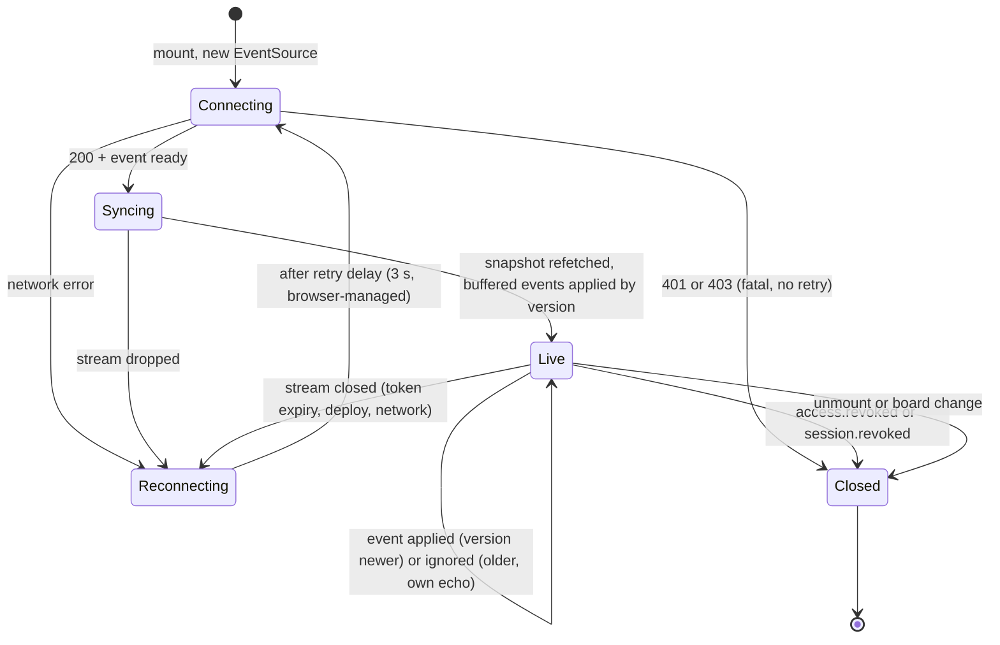

# State · SSE client connection (`useRealtime` hook)

> Index: [08 · State machines](../../08-state-machines.md) · Sequence: [19](../sequence/19-sse-connection-lifecycle.md) · Architecture: [Realtime fan-out](../architecture/06-realtime-fanout.md)

| State | UI indicator |
|---|---|
| Connecting / Syncing | none (first 2 s), then a subtle "Connecting…" |
| Live | none |
| Reconnecting > 5 s | "Reconnecting… changes may be delayed" banner |
| Closed (revoked) | redirect with an explanation |
