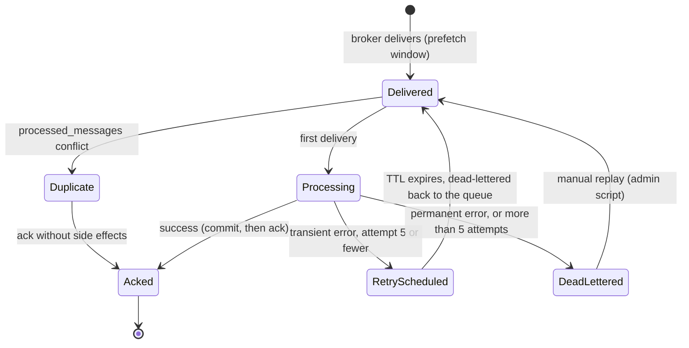

# State · RabbitMQ message consumption (per consumer)

> Index: [08 · State machines](../../08-state-machines.md) · Sequence: [18](../sequence/18-outbox-relay-and-consumers.md) · Topology: [RabbitMQ](../architecture/09-rabbitmq-topology.md)

| Error class | Examples | Path |
|---|---|---|
| Transient | DB deadlock, SMTP 4xx, RustFS timeout | `RetryScheduled` |
| Permanent | invalid payload, unknown event version, referenced row gone and not recoverable | `DeadLettered` |
| Expected no-op | ticket already deleted, recipient lost access | `Acked` (log at debug) |
