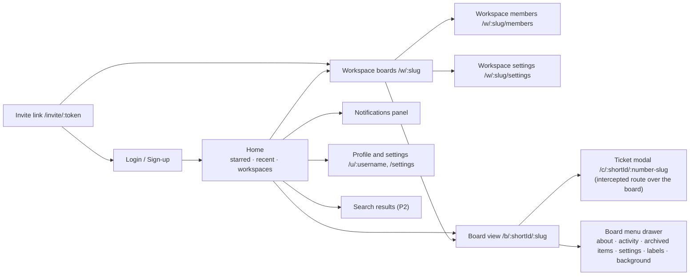

# UI · Screen map

> Index: [01 · Trello analysis §4](../../01-trello-analysis.md#4-ui-anatomy) · Routes: [04 · Architecture §5.1](../../04-architecture.md#51-route-map-app-router)

## Notes

- `/c/:shortId` opens as a **modal over the board** when you navigate client-side (Next.js intercepting route `@modal/(...)c/...`). A hard load renders it as a full page, the way Trello behaves.
- Every page under `(app)` requires a session. There are no signed-out board pages.
