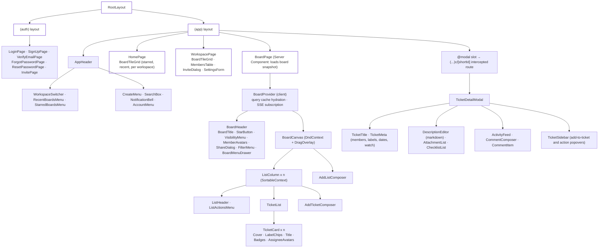

# UI · Frontend component tree (Next.js App Router)

> Index: [01 · Trello analysis §7](../../01-trello-analysis.md#7-derived-frontend-component-tree) · Routes: [04 · Architecture §5](../../04-architecture.md#5-frontend-nextjs-bff)

*Thick border = Server Component. Everything below `BoardProvider` and `TicketDetailModal` is a Client Component.*

Everything shown here lives in `apps/web`. Primitives such as buttons, dialogs, popovers and menus come from `@tb/ui`.

## Where state lives

| State | Owner |
|---|---|
| Board snapshot (lists, tickets, labels, members) | TanStack Query `['board', boardId]`, patched by SSE reducers |
| Ticket detail (description, checklists, comments, attachments) | TanStack Query `['ticket', ticketId]` |
| Drag state, composers, popovers | local component state |
| Filter (P2) | URL search params (`?label=…&member=…`) |
| Session | httpOnly cookies, never in JS |
