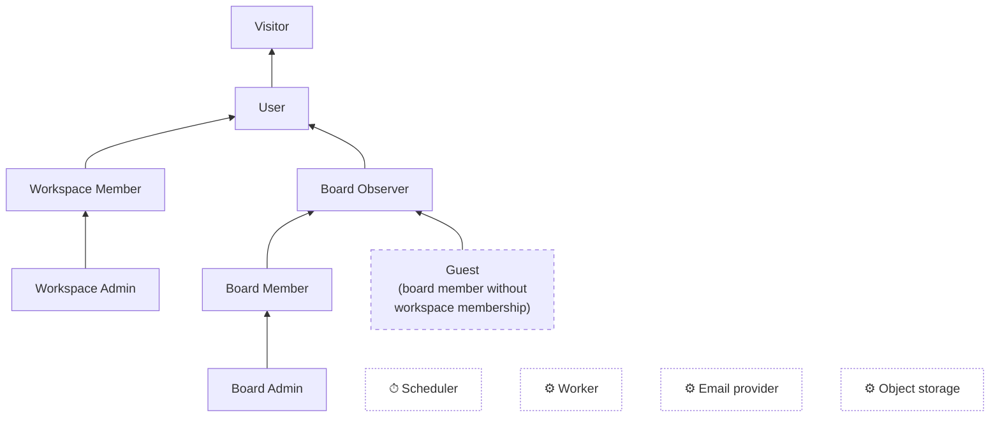

# Use case · Actor generalisation

> Index: [03 · Use cases](../../03-use-cases.md) · Actor definitions: [02 · Product scope §1](../../02-product-scope.md#1-actors)

## Reading the diagram

- Arrows read **"is a specialisation of"**: the source actor inherits every use case of the target actor.
- **Workspace roles and board roles are independent axes.** A Workspace Member isn't automatically a Board Member. They only *view* workspace-visible boards until they join.
- **Guest** (dashed) is derived at runtime and never stored. It means a board member who isn't in the board's workspace. Guests can only see the boards they were added to.
- System actors (dotted) appear in the background use cases ([06-background](./06-background.md)).
