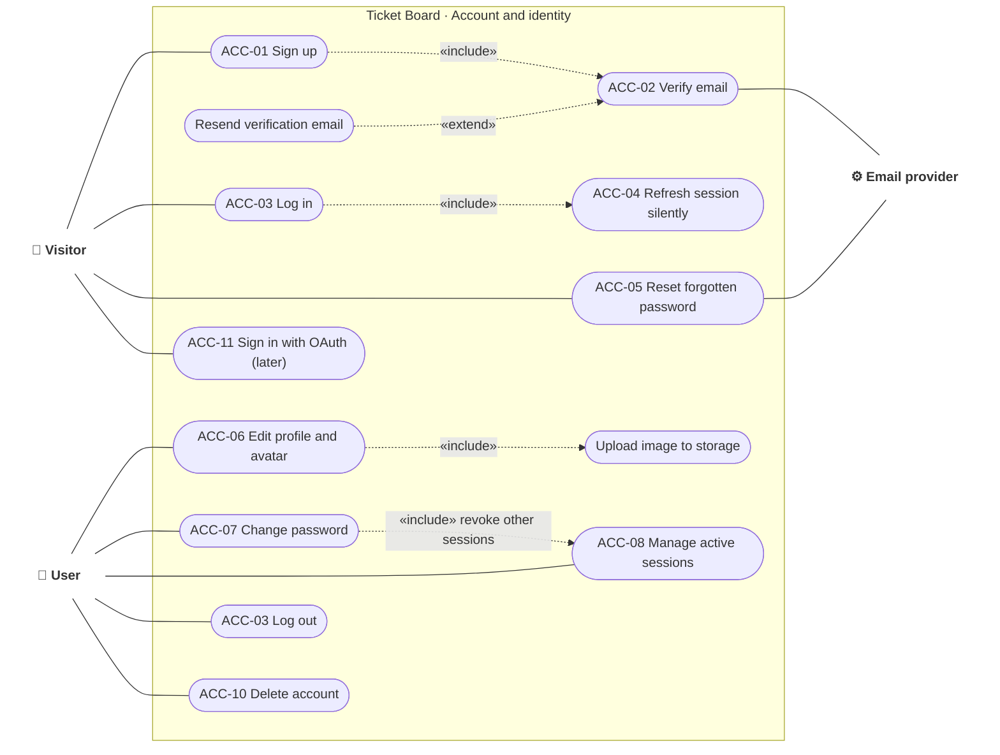

# Use case · Account and identity

> Index: [03 · Use cases](../../03-use-cases.md) · Features: ACC-01…12 · Context: Identity

---

## UC-ACC-01 · Sign up

| | |
|---|---|
| **Actor** | Visitor |
| **Preconditions** | Not signed in |
| **Trigger** | Submits sign-up form |
| **Main flow** | 1. Visitor enters email, full name, password. 2. BFF validates format. 3. API checks the email isn't registered and applies the password policy (≥ 10 chars, breached-password check P2). 4. API creates the user as `pending_verification`, derives username and initials, stores an argon2id hash. 5. Event `identity.user.registered` is written to the outbox. 6. Worker issues a verification token and emails the link. 7. Visitor sees "Check your inbox". |
| **Alternate** | 3a. Email taken → same generic response ("If this email is free, we sent a link") to prevent account enumeration. The worker emails the existing owner a "someone tried to sign up with your email" notice. 6a. Email bounce → logged, user can resend. |
| **Postconditions** | User row exists, unverified. Cannot log in until verified |
| **Related** | [Sequence 01](../sequence/01-sign-up-and-verify-email.md) · [State: User account](../state/01-user-account.md) · [State: Verification token](../state/03-verification-token.md) |

## UC-ACC-03/04 · Log in and silent refresh

| | |
|---|---|
| **Actor** | Visitor → User |
| **Main flow** | 1. Visitor submits email and password. 2. API rate-limits per IP and email, verifies the argon2id hash (dummy verify when the user doesn't exist, to equalise timing). 3. API creates a session row and returns an access JWT (15 min) and an opaque refresh token (30 days). 4. BFF stores both in httpOnly cookies. 5. Before expiry, `proxy.ts` rotates the refresh token transparently. |
| **Alternate** | 2a. Invalid credentials → generic `INVALID_CREDENTIALS`. 2b. Email not verified → `EMAIL_NOT_VERIFIED` with a resend option. 2c. Too many attempts → `RATE_LIMITED` with retry-after. 5a. Refresh token reused outside the grace window → session revoked, user logged out everywhere for that session. |
| **Related** | [Sequence 02](../sequence/02-login.md) · [Sequence 03](../sequence/03-silent-session-refresh.md) · [State: Session](../state/02-session.md) |
