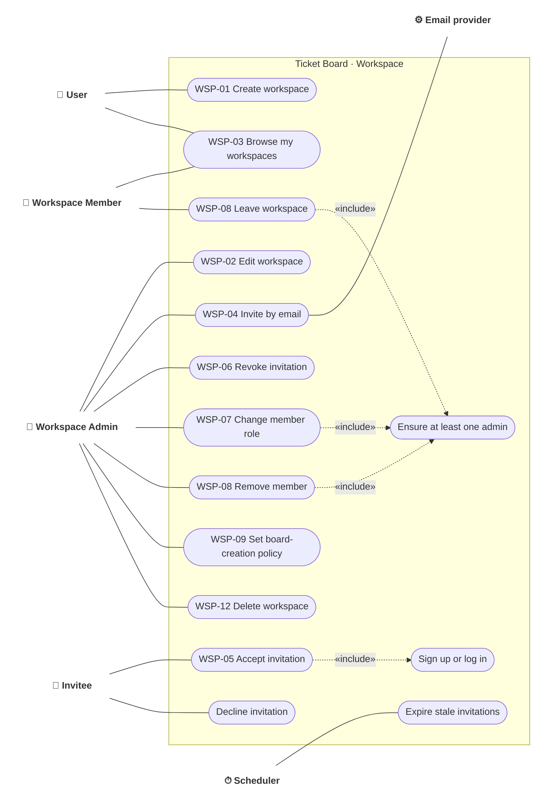

# Use case · Workspace and membership

> Index: [03 · Use cases](../../03-use-cases.md) · Features: WSP-01…12 · Context: Workspace

---

## UC-WSP-04/05 · Invite and accept

| | |
|---|---|
| **Actors** | Workspace Admin (or a board member allowed by the board invite policy), Invitee |
| **Preconditions** | Inviter has permission. Workspace/board isn't deleted or archived |
| **Main flow** | 1. Inviter enters one or more emails and a role. 2. API rejects emails that already belong to members. 3. API creates `pending` invitations (7-day TTL, hashed token). 4. Worker emails the invite link, and adds an in-app notification if the email belongs to an existing user. 5. Invitee opens `/invite/:token`. 6. If not signed in → login or sign-up, then come back. 7. Invitee accepts. 8. API adds the workspace membership and/or board membership (a board-only invite makes the invitee a guest). 9. Invitation becomes `accepted`. Board viewers see the new member live. |
| **Alternate** | 5a. Token expired or revoked → explain and offer "ask for a new invite". 7a. Invitee declines → `declined`, inviter notified. 7b. Already a member → mark accepted, redirect. |
| **Business rules** | Single use. Any signed-in account holding the token may accept (bearer link, like Trello). At most one pending email invite per (scope, email). Max 200 pending invites per workspace |
| **Related** | [Sequence 07](../sequence/07-invite-and-accept-invitation.md) · [Activity 02](../activity/02-accept-invitation.md) · [State: Invitation](../state/04-invitation.md) · [State: Workspace membership](../state/05-workspace-membership.md) |

## UC-WSP-07/08 · Change role, remove, leave

| | |
|---|---|
| **Actor** | Workspace Admin (change/remove), any member (leave) |
| **Rule** | The workspace must keep at least one admin. Demoting or removing the last admin, or the last admin leaving, fails with `LAST_ADMIN`. |
| **Side effects** | Removing a workspace member also removes them from every board in that workspace, unless they're explicit board members and the admin chooses "keep as guest" (P2). Their SSE streams for those boards close immediately. |
