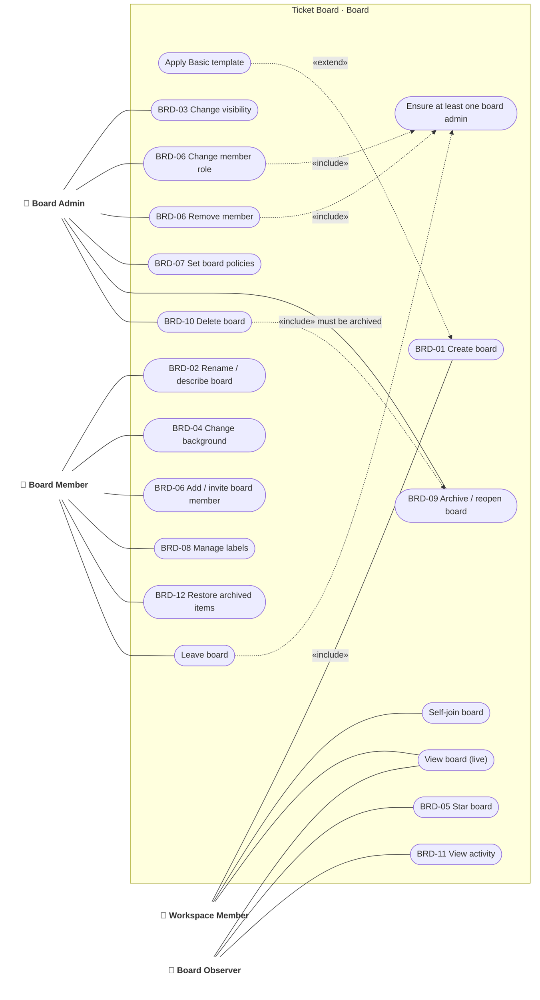

# Use case · Board management

> Index: [03 · Use cases](../../03-use-cases.md) · Features: BRD-01…18 · Context: Board

> Board Admin inherits every Board Member use case, and Board Member inherits every Observer use case (see [00-actors](./00-actors.md)). `B06a` is subject to the board's invite policy, `BJOIN` to its self-join policy, `B01` to the workspace's board-creation policy.

---

## UC-BRD-01 · Create board

| | |
|---|---|
| **Actor** | Workspace Member (subject to the workspace board-creation policy) |
| **Main flow** | 1. User enters a name, picks a background, visibility (default `workspace`) and optional "Basic" template. 2. API creates the board with a `short_id` and the 6 default unnamed labels (green, yellow, orange, red, purple, blue). The creator becomes `ADMIN`. 3. If the template was chosen, it creates the lists To Do / Doing / Done. 4. Redirect to `/b/:shortId/:slug`. |
| **Related** | [Sequence 08](../sequence/08-create-board.md) · [State: Board](../state/06-board.md) |

## UC-BRD-09/10 · Archive and delete board

| | |
|---|---|
| **Actor** | Board Admin |
| **Rules** | Archiving makes the board read-only for everyone (including admins, except for reopen/delete) and hides it from lists. Only archived boards can be deleted. Deletion is permanent: it cascades lists, tickets, comments and attachment rows, and the worker deletes the objects from storage asynchronously. |
| **Realtime** | Viewers receive `board.archived` (UI switches to read-only banner) or `board.deleted` (redirect to workspace). |
