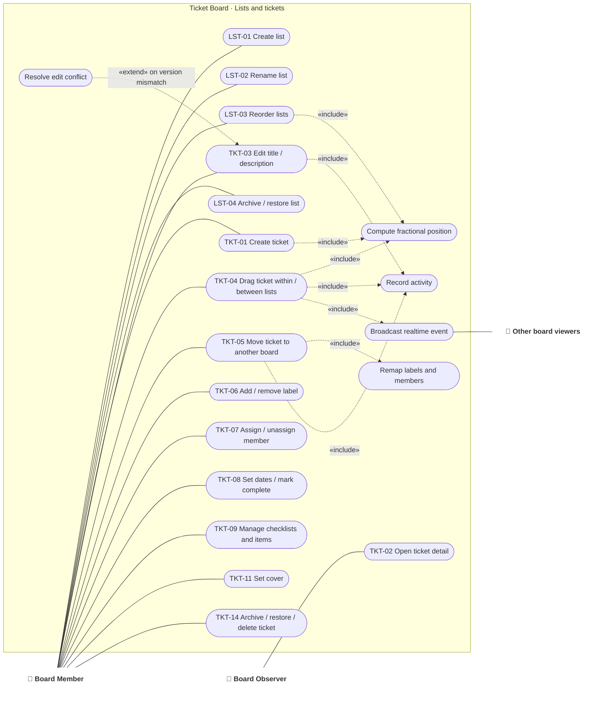

# Use case · List and ticket management

> Index: [03 · Use cases](../../03-use-cases.md) · Features: LST-*, TKT-01…09, 11, 14, 15 · Context: Board

*Every mutating use case includes "Record activity" and "Broadcast realtime event". Only a few of those arrows are drawn to keep the diagram readable.*

---

## UC-TKT-04 · Move ticket (drag and drop)

| | |
|---|---|
| **Actor** | Board Member |
| **Preconditions** | Board, source list and target list are active. Actor role ≥ MEMBER |
| **Main flow** | 1. Member drags ticket T and drops it between tickets P (above) and N (below) in list L2. 2. Client computes an optimistic key, updates its cache, renders immediately. 3. Client sends `moveTicket {ticketId, toListId, prevTicketId, nextTicketId, clientMutationId}`. 4. In one transaction, the API authorises, locks the affected list rows, resolves the real neighbours, computes the fractional key, updates T (version + 1), records activity and writes an outbox event. 5. API returns the authoritative position and version, and the client reconciles. 6. Relay publishes `board.ticket.moved`. Every API instance pushes `ticket.moved` to SSE subscribers of the board. 7. Other viewers apply the event if it's newer than their version. The originator ignores its own echo by `clientMutationId`. |
| **Alternate** | 4a. No permission → `FORBIDDEN`, client rolls back. 4b. Target list was archived or deleted meanwhile → `TARGET_LIST_UNAVAILABLE`, rollback + refetch. 4c. P is no longer in L2 → anchor on N, else append to the bottom. 4d. Network failure → rollback, toast "Couldn't move ticket". |
| **Postconditions** | Exactly one active ticket per `(list_id, position)`. Activity "moved from X to Y" exists. All viewers converge |
| **Related** | [Sequence 11](../sequence/11-move-ticket-realtime.md) · [Sequence 12](../sequence/12-concurrent-moves.md) · [Activity 04](../activity/04-move-ticket-position.md) · [State: Drag UI](../state/14-ticket-drag-ui.md) |

## UC-TKT-05 · Move ticket to another board

| | |
|---|---|
| **Actor** | Member of **both** source and target boards |
| **Main flow** | 1. Member picks target board, list and position in the Move popover. 2. API verifies membership on both boards. 3. In one transaction: lock both lists, allocate a new ticket number on the target board, remap labels (match name + color, create missing ones), drop assignees and checklist-item assignees who aren't target members, drop watchers who can't view the target, move attachments' `board_id` (object keys unchanged), update the ticket. 4. Activity on both boards. 5. Source viewers receive `ticket.removed`, target viewers receive `ticket.created`. |
| **Business rules** | Comments and activity history move with the ticket. The short link stays the same, the number changes |
| **Related** | [Sequence 13](../sequence/13-move-ticket-across-boards.md) |

## UC-TKT-03 · Edit title or description

| | |
|---|---|
| **Actor** | Board Member |
| **Main flow** | 1. Member edits text. The client sends `updateTicket {id, title?, description?, expectedVersion}`. 2. API compares versions. 3. If they match, it saves and broadcasts `ticket.updated`. |
| **Alternate** | 2a. Version mismatch → `VERSION_CONFLICT` with the current server value. The client shows "X changed this ticket while you were editing" with *Keep mine* (resubmit with the new version) or *Use theirs*. |
| **Related** | [Sequence 14](../sequence/14-edit-description-conflict.md) |
