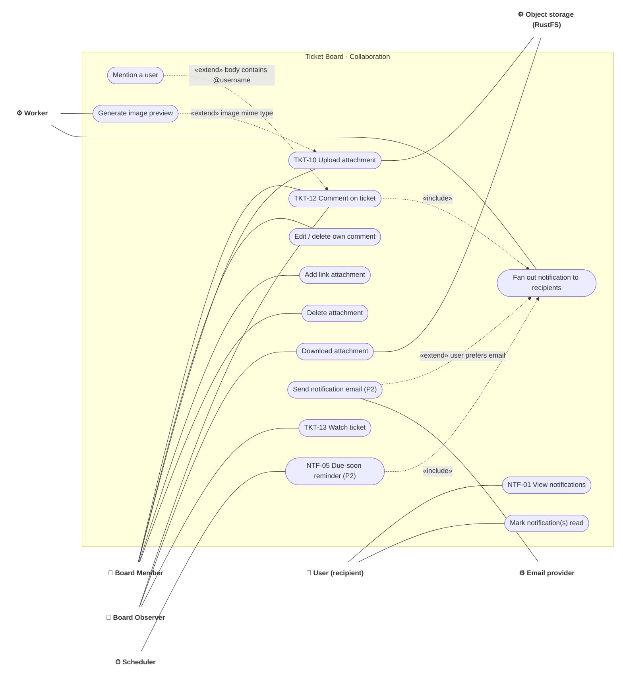

# Use case · Collaboration: comments, attachments, notifications

> Index: [03 · Use cases](../../03-use-cases.md) · Features: TKT-10, TKT-12, TKT-13, NTF-* · Contexts: Collaboration, Storage, Notification

---

## UC-TKT-12 · Comment with mention

| | |
|---|---|
| **Actor** | Board Member or Observer (per board comment policy) |
| **Main flow** | 1. Actor writes markdown containing `@username`. 2. API checks the comment policy, parses mentions and keeps only users who can view the board. 3. It saves the comment, mentions, activity and outbox event in one transaction. 4. Board viewers see the comment live. 5. The notification worker computes recipients: mentioned users ∪ watchers ∪ assignees − actor. It inserts notifications, and each recipient's bell updates live. Email goes out if the user's preference allows (P2). |
| **Rules** | Mentioning a non-member doesn't grant access and sends no notification. `@board` / `@ticket` group mentions are P2. Authors edit their own comments. Board admins may delete any comment |
| **Related** | [Sequence 15](../sequence/15-comment-mention-notification.md) · [Activity 05](../activity/05-notification-fanout.md) · [State: Notification](../state/12-notification.md) |

## UC-TKT-10 · Upload attachment

| | |
|---|---|
| **Actor** | Board Member |
| **Main flow** | 1. Member selects a file (≤ 25 MB). 2. Client requests an upload slot. The API validates size and type, creates a `pending` attachment, and returns a presigned PUT URL (5 min). 3. Browser PUTs bytes directly to RustFS. 4. Client confirms. The API HEADs the object, verifies the size, marks it `ready` and records activity. 5. For images, the worker generates a preview and emits `attachment.updated`. |
| **Alternate** | 3a. Upload fails or is aborted → the attachment stays `pending` and the GC job deletes it after 1 h. 4a. Size mismatch → `failed`, object deleted |
| **Related** | [Sequence 16](../sequence/16-attachment-upload.md) · [Sequence 17](../sequence/17-attachment-download.md) · [State: Attachment](../state/10-attachment.md) |
