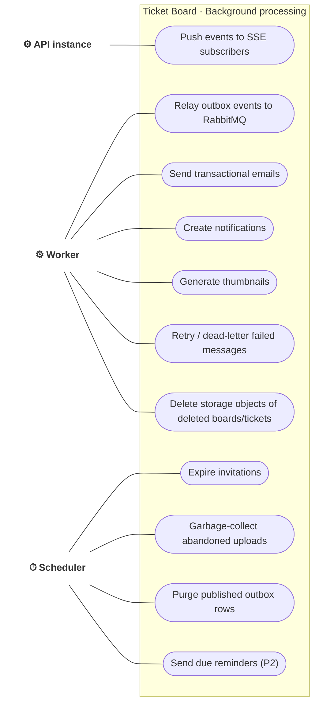

# Use case · Background processing (system actors)

> Index: [03 · Use cases](../../03-use-cases.md) · Infrastructure: [10 · Infrastructure](../../10-infrastructure.md)

| Job | Schedule / trigger | Concurrency guard | Related |
|---|---|---|---|
| Outbox relay | `LISTEN outbox_new` + 1 s poll fallback | `pg_try_advisory_lock` (single leader) | [Sequence 18](../sequence/18-outbox-relay-and-consumers.md) |
| Realtime push | RabbitMQ `tb.realtime.<instance>` | per-instance exclusive queue | [Sequence 19](../sequence/19-sse-connection-lifecycle.md) |
| Expire invitations | every 15 min | `FOR UPDATE SKIP LOCKED` | [State: Invitation](../state/04-invitation.md) |
| Upload GC | every 15 min, `pending` older than 1 h | `FOR UPDATE SKIP LOCKED` | [State: Attachment](../state/10-attachment.md) |
| Outbox purge | daily, published > 7 days | single statement | [State: Outbox event](../state/13-outbox-event.md) |
| Due reminders (P2) | every minute | `FOR UPDATE SKIP LOCKED` | [Sequence 20](../sequence/20-due-date-reminder.md) |
